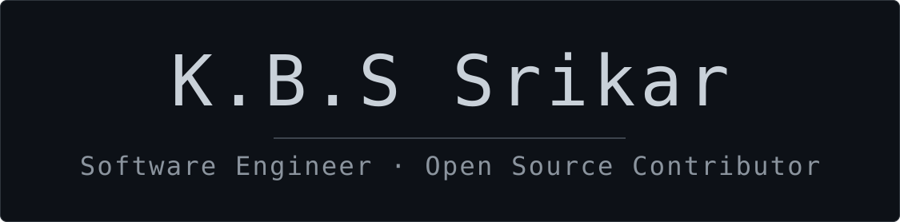

<picture>
  <source media="(prefers-color-scheme: dark)" srcset="profile-header-dark.svg" />
  <source media="(prefers-color-scheme: light)" srcset="profile-header-light.svg" />
  
</picture>

<picture>
  <source media="(prefers-color-scheme: dark)" srcset="https://raw.githubusercontent.com/kbssrikar7/kbssrikar7/main/assets/stack-dark.svg">
  <source media="(prefers-color-scheme: light)" srcset="https://raw.githubusercontent.com/kbssrikar7/kbssrikar7/main/assets/stack-light.svg">
  
</picture>

 

## Open source contributions

**[Focuser](https://github.com/aadeshrao123/Focuser) · [Open source contribution](https://github.com/aadeshrao123/Focuser/pulls?q=is%3Apr+is%3Amerged+author%3Akbssrikar7)**
Added password protection, random-text unlocking, and hidden CLI password prompts.
`Rust` `TypeScript` `React` `Tauri` `SQLite`
